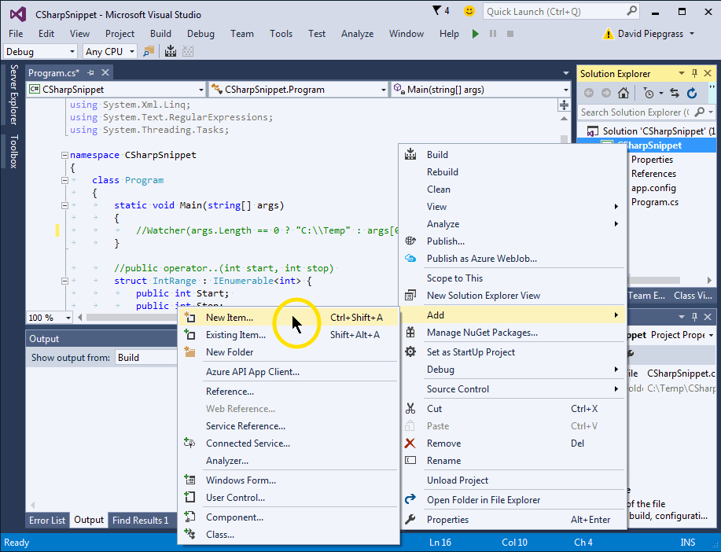
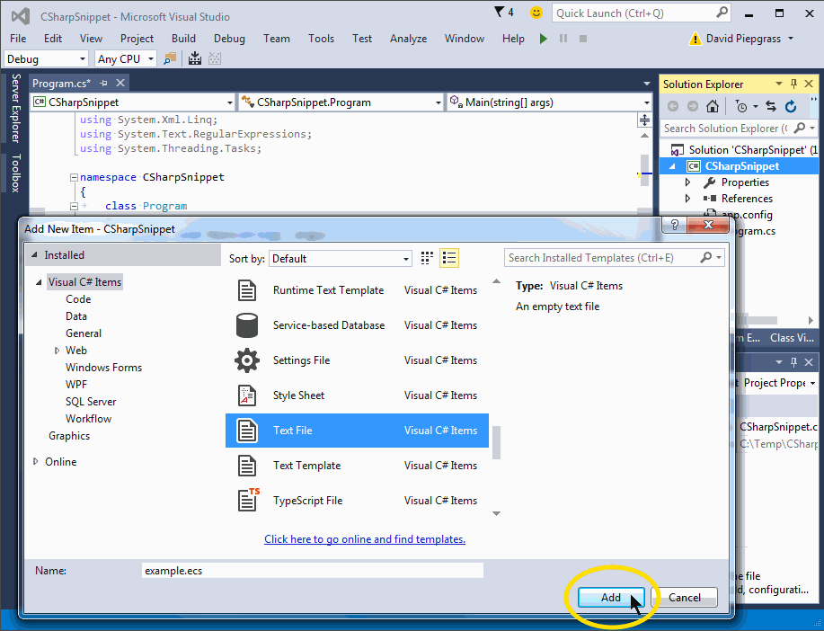
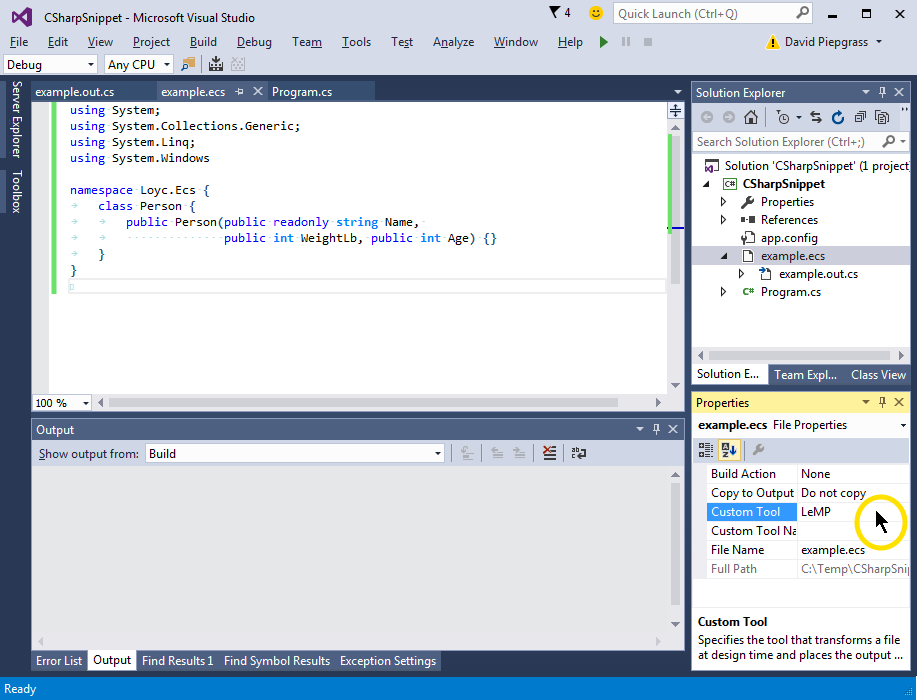
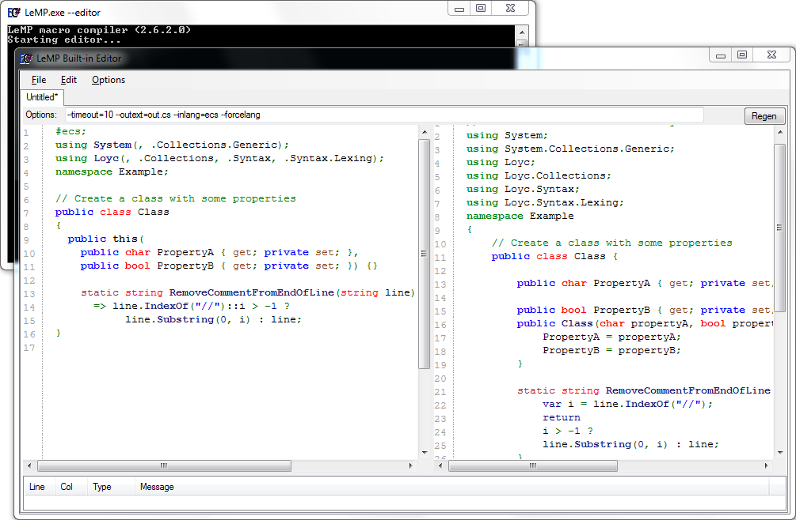

In Visual Studio
----------------

LeMP supports Visual Studio 2022 and Visual Studio 2026. To install it, download the vsix file from the [latest release page](https://github.com/qwertie/ecsharp/releases), close Visual Studio, and double-click the vsix file. The extension provides the LeMP and LLLPG Custom Tools (a.k.a. Single-File Generators) and syntax highlighting for `.ecs` and `.les` files.

The same vsix file can also be installed in Visual Studio 2017 and 2019, but these older versions are no longer tested.

**Note:** users should be aware that LeMP has a similar security risk as T4 templates (.tt files, which are natively supported by Visual Studio). LeMP and T4 templates can run any code they are instructed to run inside the file they are processing.

**Note**: If you installed a previous version of LeMP, you must uninstall it from within Visual Studio first; apparently vsix files don't support upgrades. Go to Extensions \| Manage Extensions, find the "LeMP Custom Tool" in the "Installed" section, and click Uninstall. You'll be asked to close Visual Studio. Close all instances.

### Try it out

I typically add a .cs file to my project as usual, then change the extension to .ecs. The Enhanced C# syntax highlighter should take over, and IntelliSense will stop working. Alternately, you can create a text file and give it the .ecs extension in the first place, as shown here:

Then, open the *Properties* panel and change the *Custom Tool* option to **_LeMP_**. An output file called `example.out.cs` should appear under `example.ecs`.

Finally, add some Enhanced C# code to make sure it works, e.g.

~~~csharp
using System;
using System.Collections.Generic;
using System.Linq;
using System.Windows;

namespace Loyc.Ecs {
   class Person {
      public this(public readonly string Name, 
                  public int WeightLb, public int Age) {}
   }
}
~~~

Most features of LeMP (or [LLLPG](/lllpg)) do not have any runtime dependencies, but a few do. For example:

- [Code Contracts](http://ecsharp.net/lemp/ref-code-contracts.html) can be used with or without the [Microsoft Code Contracts](https://github.com/Microsoft/CodeContracts) extension.
- Symbol literals like `@@Hello` require the `Symbol` type from Loyc.Essentials.dll, which you can find via the NuGet package manager built into Visual Studio. You can also obtain Loyc DLLs from the zip file associated with the [latest release](https://github.com/qwertie/ecsharp/releases). This feature also requires the line `#ecs;` at the top of your file.
- The [`quote`](http://ecsharp.net/lemp/ref-other.html#quote) and [`matchCode`](http://ecsharp.net/lemp/ref-other.html#matchcode) macros require at least Loyc.Syntax.dll (which provides support for [LES](http://loyc.net/les) and [Loyc trees](http://loyc.net/loyc-trees)). Loyc.Syntax uses Loyc.Collections and Loyc.Essentials. You also need Loyc.Ecs.dll if you want to parse C# code or EC# code. Again, you can get these DLLs via NuGet.
- [LLLPG](http://ecsharp.net/lllpg) is typically used with Loyc.Syntax.dll, though it can also be used without external dependencies, [as explained in the LLLPG documentation](http://ecsharp.net/lllpg/5-loyc-libraries.html).

On other platforms
------------------

All platforms support a command-line version of LeMP, LeMP.exe, and a demo window, LeMPDemo.exe. Download the zip file from the [latest release](https://github.com/qwertie/ecsharp/releases) and unzip it.

That zip file contains LeMP.exe. You can run this file directly on Windows:

    LeMP your-source-code.ecs

But on other platforms you'll typically run it with [mono](http://www.mono-project.com) or .NET Core, e.g.

    mono ./LeMP.exe your-source-code.ecs

LeMPDemo.exe is a program that lets you try it interactively:

Okay, that's it. Good luck, have fun. If you have questions, please post them on StackOverflow with the `lemp` and `ec#` tags, and I will be notified. If you find a bug or have a feature request, post it on the [issues list](https://github.com/qwertie/ecsharp/issues).